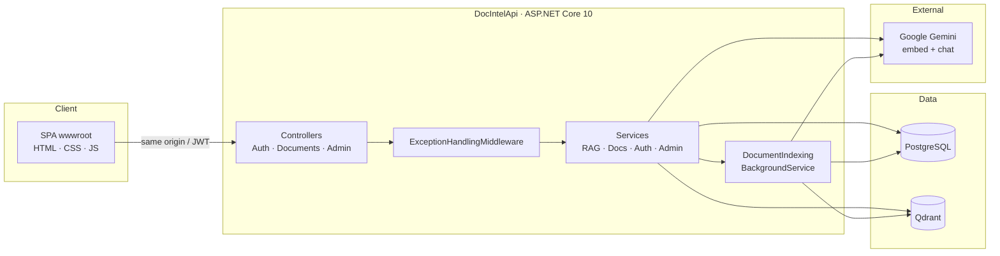
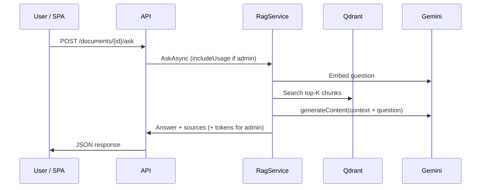

# DocIntel

Document intelligence API and UI. Upload a file, wait until it is indexed, then ask questions **grounded in that document** — not the open web.

The UI is a static SPA in `DocIntelApi/wwwroot`, served by the same ASP.NET Core 10 process as the API (same origin, no CORS).

| | |
| --- | --- |
| **Local UI** | http://localhost:5082 |
| **API docs (Scalar)** | http://localhost:5082/scalar |
| **Repo** | https://github.com/Pavelfahmi/DocIntelApi |

---

## What it does

1. **Register / sign in** with JWT (BCrypt passwords).
2. **Upload** PDF, DOCX, TXT, MD, CSV, HTML, and related text formats (max 10 MB).
3. **Background indexing** chunks text, embeds with Gemini, stores vectors in Qdrant.
4. **Ask** retrieves the top matching passages and generates an answer only from that context.
5. **Admin dashboard** shows org-wide Gemini token usage against a configurable budget.

---

## Architecture



**Request path (Ask):**



| Layer | Responsibility |
| --- | --- |
| Controllers | Auth, HTTP status codes, thin orchestration |
| `ExceptionHandlingMiddleware` | Maps exceptions → RFC 7807 `ProblemDetails` |
| Services | Business rules, RAG, indexing, admin usage |
| PostgreSQL | Users, documents, chat messages, token totals |
| Qdrant | Per-document collections `doc-{guid}` |
| Gemini | `gemini-embedding-001` + `gemini-3.5-flash` |

---

## Stack

| Piece | Role |
| --- | --- |
| ASP.NET Core 10 | API + UI (`net10.0`) |
| PostgreSQL 16 | Users, documents, chat history |
| Qdrant | Vector search (gRPC **6334**) |
| Gemini | Embeddings and grounded answers |
| Docker Compose | Local / demo orchestration |

---

## How to run

### Prerequisites

- Docker Desktop (recommended), **or** .NET 10 SDK + Docker only for Postgres/Qdrant
- A Gemini API key from [Google AI Studio](https://aistudio.google.com/apikey)

### 1. Secrets

```bash
copy .env.example .env
```

Edit `.env`:

```
Jwt__Secret=a-random-string-you-generate-at-least-32-chars
Gemini__ApiKey=your-own-gemini-key
```

`.env` is gitignored. Never commit keys into `appsettings.json` or compose files.

### 2. Docker (recommended)

```bash
docker volume create docintel_pgdata
docker volume create qdrant_storage
docker compose up --build -d
```

Open http://localhost:5082

| Container | Host port | Restart |
| --- | --- | --- |
| `docintel-api` | 5082 → 8080 | `unless-stopped` |
| `docintel-postgres` | 5433 → 5432 | — |
| `qdrant` | 6333 / 6334 | — |

```bash
docker compose down
```

### 3. API on the host (optional)

```bash
docker compose up -d postgres qdrant
cd DocIntelApi
dotnet user-secrets set "Jwt:Secret" "replace-with-at-least-32-characters"
dotnet user-secrets set "Gemini:ApiKey" "YOUR_GEMINI_KEY"
dotnet run --launch-profile http
```

Host config expects Postgres on **localhost:5433** and Qdrant gRPC on **localhost:6334**.

---

## Secrets (how they stay off git)

| Store | In git? | Used by |
| --- | --- | --- |
| `.env` | No | Docker Compose (`Jwt__Secret`, `Gemini__ApiKey`) |
| `dotnet user-secrets` | No | `dotnet run` on the host |
| `appsettings.json` | Yes | Empty placeholders only |

Optional on Windows: copy `docker-compose.override.example.yml` → `docker-compose.override.yml` to mount user-secrets into the API container.

---

## Development admin

In **Development**, the seeder creates:

- Email: `admin@docintel.local`
- Password: `Admin123!`

Do not use this in production. Set `ASPNETCORE_ENVIRONMENT=Production` and create a real admin (emails listed under `Admin:Emails`).

---

## How indexing & Ask work

1. **Upload** extracts text → 500-word chunks (100-word overlap) → status `Pending` → enqueue.
2. **Background worker** embeds chunks (`RETRIEVAL_DOCUMENT`) → Qdrant `doc-{id}` → status `Ready` (or `Failed`).
3. **Ask** embeds the question (`RETRIEVAL_QUERY`) → top 5 passages → Gemini answers **only** from that context.

Indexing is in-memory. Restarting the API while a document is `Pending`/`Processing` can leave it stuck until re-upload. The API service uses `restart: unless-stopped` so the container comes back after Docker/host restarts.

---

## API

All document and admin routes need `Authorization: Bearer <token>`.

| Method | Path | Notes |
| --- | --- | --- |
| `POST` | `/api/v1/auth/register` | 201 / 409 |
| `POST` | `/api/v1/auth/login` | 200 / 401 |
| `POST` | `/api/v1/documents` | multipart, 202 Accepted |
| `GET` | `/api/v1/documents` | current user |
| `GET` | `/api/v1/documents/{id}` | |
| `DELETE` | `/api/v1/documents/{id}` | also drops the Qdrant collection |
| `POST` | `/api/v1/documents/{id}/ask` | `{ "question": "...", "topK": 5 }` |
| `GET` | `/api/v1/admin/usage` | admin token dashboard |

Postman: `DocIntelApi/postman/DocIntelApi.postman_collection.json`

Unhandled failures return `application/problem+json` via global exception middleware (validation errors, AI 503 busy, auth failures, etc.).

---

## Supported files

PDF, DOCX, TXT, MD, CSV, JSON, XML, HTML, RTF, LOG. Image-only PDFs are not OCR’d. Legacy `.doc` is not supported (save as `.docx`).
